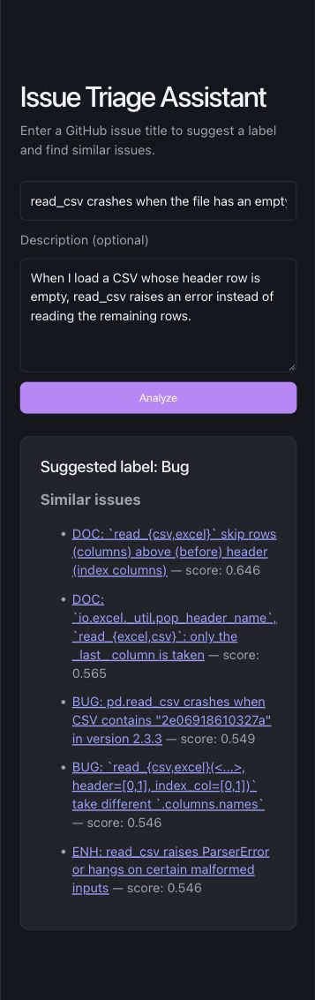

# Issue Triage Assistant

An issue triage demo for pandas GitHub issues. Enter a title and optional description to get a suggested `Bug`, `Docs`, or `Enhancement` label and five related issues to review.

**[Try the live demo](https://issue-triage-sreszx22aynsgym2mtkwes.streamlit.app/)** · [View the source code](https://github.com/Jyotshana111/issue-triage)



The project has three parts:

1. **Python and FastAPI** collect issue data, train a classifier, search issue embeddings, and expose `/analyze` on port 8000.
2. **Java and Spring Boot** expose `/api/analyze` on port 8080 and forward requests to Python.
3. **React and Vite** provide the browser interface. Vite proxies `/api` requests to Java.

## Public demo

The repository also includes `streamlit_app.py`, a [public demo](https://issue-triage-sreszx22aynsgym2mtkwes.streamlit.app/) that runs the **same saved classifier and sentence-embedding search** directly in Python. It has its own Streamlit interface so it can run on Streamlit Community Cloud without deploying three servers. The React, Java, and FastAPI application remains the full-stack version of the project.

The first analysis may take longer while the sentence-transformer downloads. Community Cloud may put an idle app to sleep; a visitor can wake it from the sleep page. The indexed data and model are included in this repository, so deployment does not need to call the GitHub issue API.

To preview this public demo locally after installing the Python requirements, run `python -m streamlit run streamlit_app.py` from the repository root.

## Requirements

- Python 3.12
- Java 21 or newer
- Node.js 20.19.x or 22.12+
- Internet access for the first issue collection and sentence transformer model download

## Start locally

Run the following commands from the `issue-triage` directory. Use a separate terminal for each server.

### 1. Prepare data and run Python

```bash
python3.12 -m venv .venv312
source .venv312/bin/activate
python -m pip install -r requirements.txt
python collect.py
python train.py
python -m uvicorn api:app --reload --port 8000
```

`collect.py` downloads the 1,000 most recent pandas issues selected by its GitHub search query. `train.py` prints held-out classification metrics, saves `issue_model.joblib`, and builds the local `issue_embeddings.npz` cache. The first run downloads the `sentence-transformers/all-MiniLM-L6-v2` model.

### 2. Run Java

```bash
cd issue-triage-backend
./mvnw spring-boot:run
```

The Java health endpoint is `http://127.0.0.1:8080/health`.

### 3. Run React

```bash
cd frontend
npm ci
npm run dev
```

Open the local URL printed by Vite. Its port may be 5173 or another available port.

## Checks

With the three servers running, submit an issue in the browser and confirm that it shows one suggested label and five related issues. The project also supports these local checks:

```bash
cd frontend && npm run lint && npm run build
cd ../issue-triage-backend && ./mvnw test
```

## Try the API

With all three servers running:

```bash
curl -X POST http://127.0.0.1:8080/api/analyze \
  -H 'Content-Type: application/json' \
  -d '{"title":"read_csv crashes when the file has an empty header","body":"An empty CSV header causes an error."}'
```

## How it works

- The classifier combines TF-IDF word features with sentence embeddings, then uses logistic regression. Training excludes issues that have none or multiple of the three target labels.
- Related issues are ranked by cosine similarity between normalized sentence embeddings. A score is a text similarity measure, **not** the probability that two issues are duplicates.
- Issue title prefixes such as `BUG:` and `DOC:` are removed before training, so the model cannot rely on those obvious label hints.

The current dataset contains 1,000 recent issues. Search can only return issues in that collection, so some queries have no close match. Similarity results require human review; the project has no verified duplicate-pair benchmark yet.
